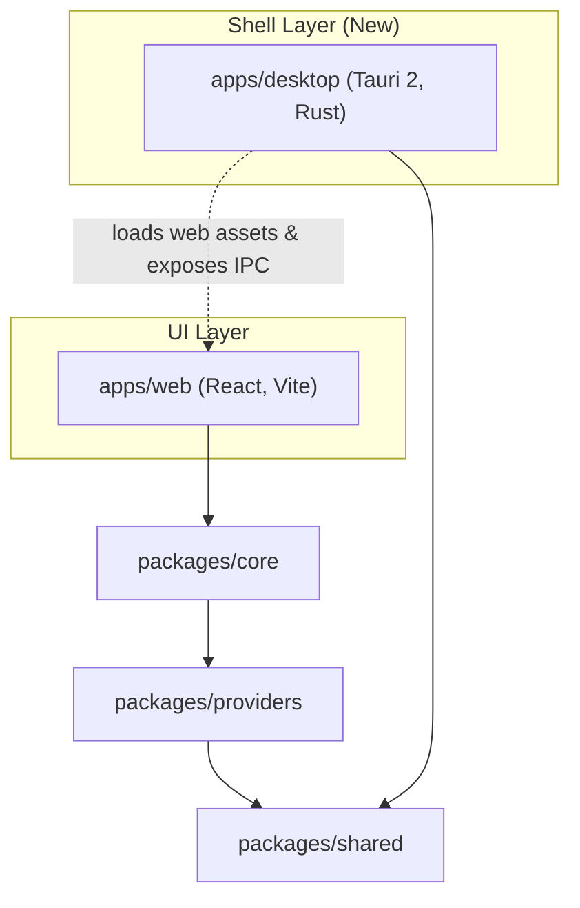
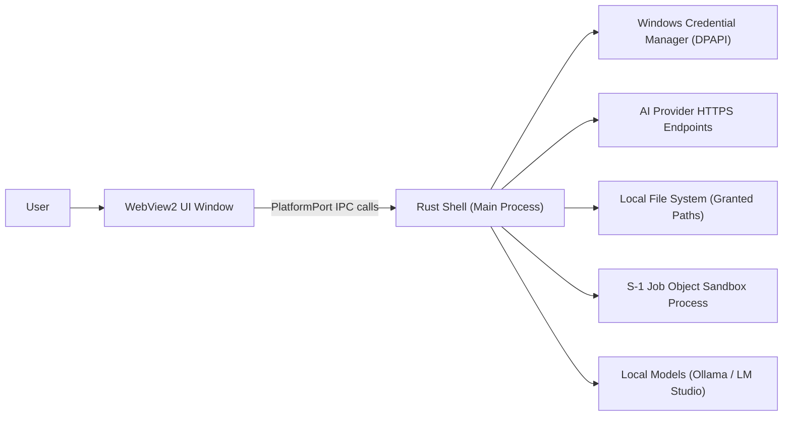
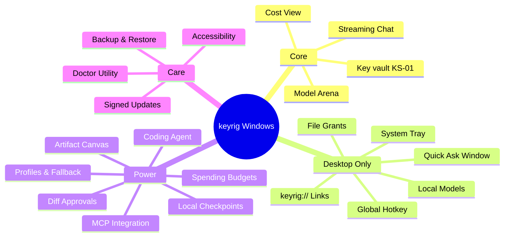
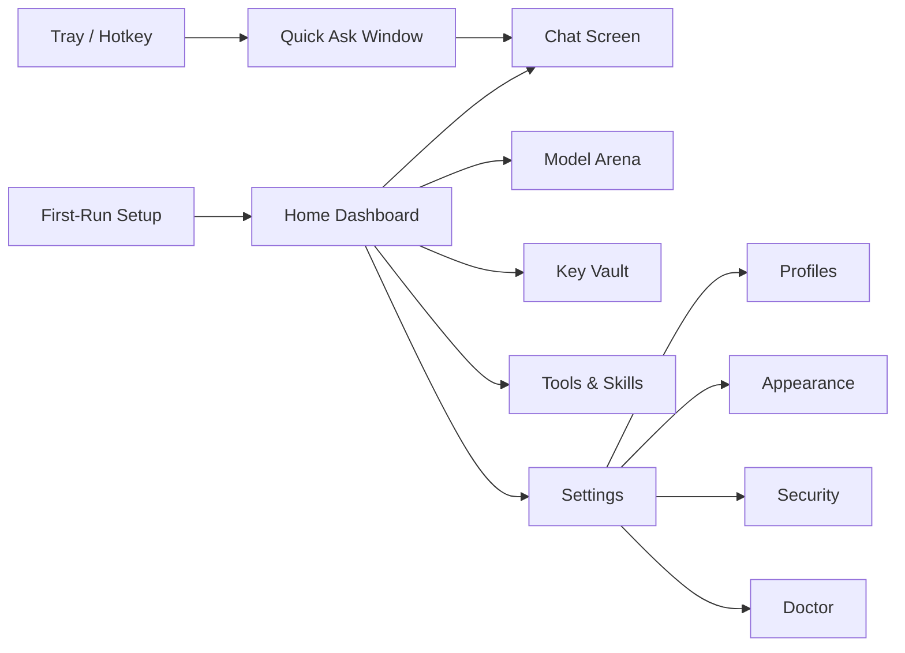
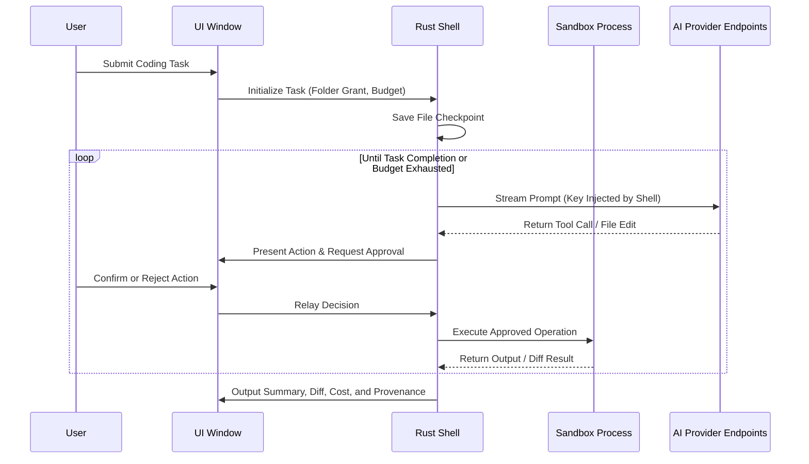
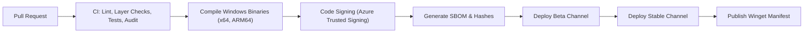
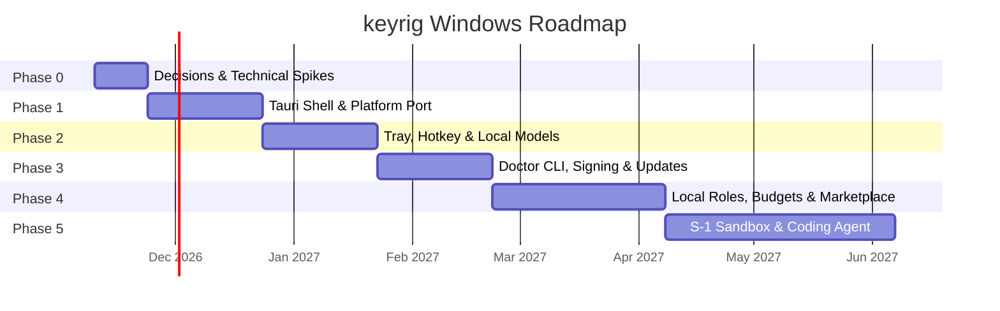

# keyrig for Windows: Master Plan

Status: DRAFT 2 for owner review  
Date: 2026-11-06  
Scope: Planning only. No code is modified in this document.  
Style: ASD-STE100 (Simplified Technical English).  

---

## 0. How to read this plan

- Each section has one purpose.
- Each decision has an ID (for example, `WD-03`). Use the ID when you review.
- The owner can accept, change, or reject each decision.
- Items marked **[OPEN]** need an owner answer.
- Items marked **[CONFLICT]** conflict with an existing keyrig decision (D-01 to D-06).

---

## 1. Summary

keyrig is a BYOK (Bring Your Own Key) AI harness. One key connects to many AI models. The web app exists in `apps/web`. The desktop app does not exist.

The Windows app puts keyrig on the user PC. It stores keys in the Windows Credential Manager. It works offline. It starts from the system tray, from a global hotkey, and from the command line. It strictly keeps the five product rules (PR-01 to PR-05).

The web app stays the main product. The Windows app is the same app in a native shell. It is not a separate product.

### 1.1 Goals

1. Store keys in the Windows Credential Manager using DPAPI (KS-01).
2. Reuse more than 90% of the `apps/web` code.
3. Start in less than 1.5 seconds on a mid-range PC.
4. Work completely offline with no network (PV-01).
5. Give desktop capabilities: system tray, global hotkey, local folder grants, local models, and an isolated sandbox.
6. Keep PR-01 to PR-05 true. Tests prove every rule.

### 1.2 Non-goals (for v1)

- No keyrig server (D-04). All data stays on the local device.
- No team or multi-user accounts (D-06).
- No telemetry, tracking, or remote logging (PR-05).
- No macOS or Linux build in this plan. The design must not block them later.
- No mobile applications.

---

## 2. Principles

| ID | Principle | Meaning |
|----|-----------|---------|
| WP-01 | One codebase | The desktop app loads the same `apps/web` UI. The desktop code is a thin shell. |
| WP-02 | Keys never leave the shell | The UI cannot read a raw key after it is saved. Only the Rust shell sends requests with the key. |
| WP-03 | Offline first | Every screen starts with no network access. |
| WP-04 | Small and fast | Small installer. Low memory usage. Fast startup. |
| WP-05 | Ask before power | File access, command execution, and network access to private addresses require user approval. |
| WP-06 | Honest UI | Every answer shows model, key label, tokens, and price state (PR-02, PR-03). |
| WP-07 | Easy to remove | The uninstaller removes the app completely. The user can also choose to remove all local data. |

---

## 3. Technology decision

### 3.1 Options

| Option | Good | Bad |
|--------|------|-----|
| **Tauri 2** (Rust + WebView2) | Small installer (5–15 MB). Low RAM. Fine-grained permissions. Strong DPAPI and sandbox support. | Requires Rust knowledge. Requires WebView2 runtime (pre-installed on Windows 10/11). |
| Electron | Broad developer familiarity. Bundles Chromium. | Large installer (over 100 MB). High RAM. Larger attack surface. |
| .NET MAUI / WinUI | Native look. | Cannot reuse React code directly. Becomes a second product. |
| PWA only | Zero new code. | No Credential Manager. No system tray. No folder grants. Fails primary goals. |

### 3.2 Decision

**WD-01: Use Tauri 2.**

Reasons:
1. Reuses the existing React and Vite web codebase without rewrite.
2. The installer is small (under 20 MB).
3. The Rust shell provides secure key handling and process isolation.
4. The Tauri capability system enforces least-privilege permissions out of the box.

Fallback: If WebView2 issues block development, switch the shell to Electron. The Platform Port contract keeps the shell thin to allow this change.

---

## 4. Architecture and layer rules

### 4.1 Layer hierarchy

The project follows a strict downward dependency hierarchy:
`apps/web` and `apps/desktop` -> `packages/core` -> `packages/providers` -> `packages/shared`.



Rules:
- `apps/desktop` hosts `apps/web` as its user interface inside WebView2.
- `apps/web` must never import directly from `apps/desktop`.
- `apps/web` talks to native services only through the Platform Port.
- `tools/check-layers.mjs` checks and enforces dependency boundaries for `apps/desktop`.

### 4.2 Process model



Key security point:
- In desktop mode, the Rust shell makes the provider request, not the UI.
- The UI passes a request ID and key label.
- The shell reads the key from Credential Manager, injects it into the request, and streams chunks back.
- The raw secret key never enters the WebView2 memory space. Memory is zeroized after use.

### 4.3 Data stores

| Data | Where | Notes |
|------|-------|-------|
| API Keys | Windows Credential Manager | Stored via DPAPI under `keyrig:<label>`. |
| Web Vault Fallback | Disabled on Desktop | Desktop uses Credential Manager exclusively (KS-01). |
| Settings, Profiles, History | `%APPDATA%\keyrig\keyrig.db` | SQLite database encrypted with a DPAPI-derived key. |
| Model Catalog Cache | `%LOCALAPPDATA%\keyrig\cache\` | Safe to delete; regenerates on demand. |
| Application Logs | `%LOCALAPPDATA%\keyrig\logs\` | Redacted. Never records secrets or prompt text. |
| Artifact Exports | `%APPDATA%\keyrig\artifacts\` | User-controlled export files. |

---

## 5. The Platform Port

The UI must run in two environments: browser and desktop. The Platform Port is a unified TypeScript interface.

### 5.1 Interface specification

```ts
export interface KeyMetadata {
  label: string;
  provider: string;
  createdAt: number;
}

export interface GrantedFolder {
  path: string;
  writable: boolean;
  grantedAt: number;
}

export interface PlatformPort {
  keys: {
    list(): Promise<KeyMetadata[]>;
    save(label: string, secret: string, provider: string): Promise<void>;
    remove(label: string): Promise<void>;
    test(label: string): Promise<{ ok: boolean; message?: string }>;
  };
  net: {
    streamRequest(req: ProviderRequest): AsyncIterable<StreamChunk>;
  };
  files: {
    requestFolderAccess(): Promise<GrantedFolder | null>;
    listGrants(): Promise<GrantedFolder[]>;
    revokeGrant(path: string): Promise<void>;
  };
  window: {
    showQuickAsk(): void;
    hideQuickAsk(): void;
    setTrayIcon(enabled: boolean): void;
    setHotkey(combo: string): void;
  };
  updates: {
    check(): Promise<UpdateInfo | null>;
    install(): Promise<void>;
  };
  system: {
    openExternal(url: string): void;
    version(): { app: string; os: string };
  };
}
```

### 5.2 Shell contract

- The port has no method that returns a raw secret key. Tests enforce this (PR-01).
- The web adapter uses the WebCrypto vault in `packages/core/src/keys/vault.ts` (KS-02).
- The desktop adapter routes calls over Tauri IPC to Rust handlers (KS-01).
- Adding a native feature requires adding a port method and updating both adapters. This keeps the shell thin.

**WD-02: All native access occurs strictly through the Platform Port.**

---

## 6. Security plan

### 6.1 Threats and controls

| Threat | Control | Rule |
|--------|---------|------|
| Malware reads key file | Keys live in Credential Manager (DPAPI). No plain key file on disk. | PR-01 |
| XSS in UI steals key | UI never holds a raw key. Strict CSP. No remote scripts. | PR-01 |
| Malicious page loaded in app | The app loads only bundled local assets. External URLs open in system browser. | PR-01 |
| Prompt injection runs bad command | Explicit user approval required. Job object sandbox. Deny list. | PR-04 |
| SSRF to private addresses | Warn on local/private addresses. Block cloud metadata IPs (`169.254.169.254`). | PR-04 |
| Tampered installer | Code signing. Signed update manifests. Cryptographic hash check. | PR-04 |
| Tampered update | Signature verification using a pinned public key. | PR-04 |
| Key leak in logs | Key patterns are redacted before logging. Automated tests check this. | PR-01, PR-04 |
| Key leak in crash dump | Crash reporting is disabled. Local dumps only. Key memory zeroed after use. | PR-01, PR-05 |
| Clipboard leak | Key fields never copy to clipboard by default. Optional auto-clear after 30 seconds. | PR-01 |

### 6.2 Tauri capability rules

- Deny all permissions by default.
- Allow each command explicitly by name in capability JSON files.
- The UI window has no direct file system access, shell access, or HTTP plugin access.
- Only the specific Rust commands of the Platform Port are exposed.
- The CSP blocks `eval` and inline scripts.

### 6.3 Unlock options

| ID | Option | Note |
|----|--------|------|
| WU-01 | Windows sign-in is enough | Default. Credential Manager already binds keys to the Windows account. |
| WU-02 | Windows Hello before key use | Optional. Requests PIN, face, or fingerprint before key release. |
| WU-03 | App lock after idle time | Optional. Locks the UI window. Keys remain in secure storage. |

**WD-03: WU-01 is default. WU-02 and WU-03 are user settings.** [OPEN: confirm]

### 6.4 Security release gates

Before every release:
1. `npm audit` and `cargo audit` pass with zero high or critical findings.
2. All tests that assert PR-01 to PR-05 pass.
3. Automated scanners detect no key patterns in logs, installer, or database files.
4. A manual audit reviews the capability definition file.
5. An SBOM (Software Bill of Materials) is generated and archived with the release.

---

## 7. Feature plan

### 7.1 Feature map



### 7.2 Desktop-only features

| ID | Feature | Detail |
|----|---------|--------|
| WF-01 | System tray icon | App runs minimized. Left-click opens main window. Right-click opens menu (Quick Ask, Arena, Lock, Quit). |
| WF-02 | Global hotkey | Default `Ctrl+Alt+K`. Opens the Quick Ask overlay window above other applications. User configurable. |
| WF-03 | Quick Ask window | Floating compact window. Single input field, model selector, streaming response, and "Open in full app" button. |
| WF-04 | Start with Windows | Optional user setting. Disabled by default. |
| WF-05 | `keyrig://` links | Deep link to open chats, provider setups, or import profiles. Always requires user approval. |
| WF-06 | Local model finder | Detects Ollama (`127.0.0.1:11434`) and LM Studio (`127.0.0.1:1234`). Displays connection status. One-click setup. |
| WF-07 | File folder grants | User selects a folder via native picker. App reads/writes only inside granted paths. Grants can be revoked. |
| WF-08 | Drag and drop | Drop files or folders directly into the chat prompt to attach them. |
| WF-09 | Screenshot ask | Hotkey captures screen region and attaches it to a multimodal prompt. Asks for confirmation first. |
| WF-10 | Native notifications | Windows toast notification when a long run finishes or needs approval. |
| WF-11 | Jump list and taskbar | Taskbar jump list: New Chat, Quick Ask, Arena. Badge displays pending approval count. |
| WF-12 | Share target | Windows Explorer context menu: "Ask keyrig" (Phase 3). |
| WF-13 | Backup and restore | Export settings and history to an encrypted archive. Keys are excluded unless explicitly opted in. |
| WF-14 | Portable mode | Optional ZIP package. Data resides alongside executable. Keys still use Credential Manager. |

### 7.3 Features shared with web (identical behavior)

- Key vault management, streaming chat with Stop functionality.
- Provenance on every response (model ID, key label, token counts, price state) (PR-02).
- Cost estimation. Unknown prices display as "unknown" (PR-03).
- Model arena comparisons.
- Clear error dialogs providing exactly one action to fix (PR-04).
- Dark and light themes. Support for `prefers-reduced-motion`.

### 7.4 Features not built yet (roadmap items)

| Item | Desktop Implementation |
|------|------------------------|
| Provider profiles, fallback chains, model migration | Stored in local SQLite. Same core logic as web. |
| Budgets and run limits | Enforced inside Rust shell so UI bugs cannot bypass limits. |
| Artifact canvas | Adds "Open in default application" and "Show in folder" native actions. |
| Checkpoints | Uses local filesystem snapshot archives. |
| Approvals | Uses native toast notifications and modal diff dialogs. |
| MCP integration | Shell launches and manages MCP servers as sandboxed child processes. |
| Coding agent | Sandboxed process execution. See Section 11. |
| Doctor command and CLI | Integrated diagnostic tool. See Section 10. |
| Persistent settings | Local SQLite database. |

---

## 8. Planned additions (from 2026-11-04 notes)

### 8.1 User profile settings

- Custom agent tool definitions and editing.
- Pre-packaged tool modifications.
- Appearance and theme preferences.
- Home dashboard status.
- Desktop plan: Data lives in local SQLite database. Uses existing web UI components.

### 8.2 User-made tools

Users can author tools with assistance from agents.

Rules:
1. Show a warning dialog before tool creation and before initial execution.
2. Display all requested permissions: files, network hosts, system commands.
3. New tools start with zero permissions. The user grants each privilege.
4. Tools authored by an agent remain flagged as "agent-made" until owner review.
5. User tools execute exclusively inside the isolated sandbox (Section 11).

### 8.3 Tool and skill marketplace

**[CONFLICT]** with D-04 (no server). Notes mention storing marketplace data on a remote backend.

Options:

| Option | Description | Effect on D-04 / PR-01 / PR-05 |
|--------|-------------|--------------------------------|
| **M-A** | Static, cryptographically signed JSON index on CDN. App only downloads. Sends zero user data. | Preserves D-04 and PR-05. Best fit. |
| M-B | Live dynamic backend with user accounts. | Violates D-04. Requires new privacy and security architecture. |
| M-C | Optional marketplace module. Disabled by default. Core stays server-free. | Preserves core promise. Increases complexity. |

**WD-04: Start with M-A (static signed index).** Move to M-C only if user accounts become mandatory. [OPEN: owner decision]

Marketplace safety rules:
- Every package requires a cryptographic signature and hash verification.
- Every package declares required capabilities. The user reviews them before install.
- No automatic installations or silent permission escalation.
- Packages never access raw keys; they can only request to use a key label via the shell.

### 8.4 Administration and roles

**[CONFLICT]** with D-06 (single-user design) and D-04 (no server).

Local-only model (no conflict):

| Role | Meaning |
|------|---------|
| Owner | Complete administrative access on this PC. |
| Guest Profile | Restricted tools, locked key management, spending caps. Ideal for shared family PCs. |

Online administration dashboards and remote user roles require a server backend and require a formal decision record (`D-07`).

**WD-05: Desktop v1 provides local roles only (Owner, Guest). Remote administration is deferred.** [OPEN: owner decision]

### 8.5 Usage streaks

- Tracks consecutive active chat days locally.
- Displays a streak badge on the home dashboard.
- Includes a setting to disable tracking completely. When disabled, data is erased.
- Zero sharing. Zero leaderboards (PR-05).

### 8.6 Feature requests page

- v1 implementation: Button opens a pre-filled GitHub issue template in the system browser.
- No telemetry or forms submit data from within the application.

---

## 9. UI and design plan

### 9.1 Design system

- Keep brand colors: Amber (`#F5B83D`) signifies Key state; Cyan (`#3DD6C6`) signifies AI Link state. Never swap.
- Typography: Inter for text prose; JetBrains Mono for code, keys, and numeric data.
- Bundle font files locally. Never load external web fonts over the network.
- Dark theme is default. Light theme must work cleanly. Full support for `prefers-reduced-motion`.

### 9.2 Windows-specific polish

| Item | Implementation Plan |
|------|---------------------|
| Window Frame | Custom title bar integrating native Windows 11 snap layouts. Standard window controls. |
| Backdrop | Mica effect on Windows 11 where supported. Solid background on Windows 10. |
| High DPI | Full testing across 100%, 125%, 150%, and 200% display scaling. |
| Keyboard Navigation | Comprehensive keyboard accessibility. Command palette accessible on `Ctrl+K`. |
| Screen Readers | Verified with Windows Narrator and NVDA. |
| Contrast Themes | Full support for Windows High Contrast modes. |

### 9.3 Reference direction

Visual inspiration draws from igloo.inc and high-polish WebGL environments in two specific locations:
1. **First-run onboarding**: A short, interactive 3D key vault moment. The amber key turns and the cyan link activates. Must be skippable. Must respect reduced motion.
2. **Home dashboard**: A lightweight canvas background behind operational status cards.

Operational screens (chat, arena, settings) remain lightweight and flat. Heavy graphics must never degrade task workflows.

Performance limits:
- 60 FPS on integrated graphics; automatically disables scene if framerate drops.
- Automatically pauses rendering when the application window is hidden or minimized.
- Lazy loads rendering libraries. Quick Ask window never loads 3D assets.
- A "Lite Mode" setting completely disables all canvas and 3D scenes.

### 9.4 Screen flow



### 9.5 First-run flow

1. Welcome screen (skippable 3D scene).
2. Privacy declaration: "Your keys stay on this PC" (PR-01).
3. Add initial API key or detect active local model (Ollama / LM Studio).
4. Verify key connectivity. Display clear test result.
5. Send first test message. Display provenance stats and request cost.
6. Offer optional shortcuts: system tray, global hotkey, launch on startup (disabled by default).

Target: First successful answer delivered in under 2 minutes.

---

## 10. Doctor and CLI

### 10.1 Diagnostic doctor

A dedicated diagnostic screen and CLI command. Evaluates system state and provides one specific fix action per failure:

| Diagnostic Check | Fix Action on Failure |
|------------------|----------------------|
| WebView2 Runtime available | Display direct link to Microsoft Evergreen Bootstrapper installer. |
| Credential Manager accessible | Guide user to restart the Windows Credential Manager service. |
| AI Provider reachable | Show endpoint status. Offer retry button. |
| API Key validity | Prompt user to re-enter key. |
| Local model running | Display start command (`ollama run <model>`). |
| System clock sync | Open Windows Date & Time settings to correct clock skew. |
| Firewall / Proxy | Display hostnames requiring firewall pass-through. |
| Disk space | Provide one-click cache cleanup button. |
| Updates available | Display release notes and update trigger. |

Doctor diagnostics have a "Copy Report" button. The report contains **zero keys** and **zero prompt text**.

### 10.2 Command line interface (CLI)

The `keyrig` CLI utility installs alongside the desktop app:

```text
keyrig doctor              # Runs system diagnostic suite
keyrig keys list           # Displays key labels and providers (no secrets)
keyrig ask --model <id>    # Sends single prompt via desktop daemon
keyrig arena "prompt"      # Compares responses across models
keyrig profile export      # Exports encrypted profile archive
keyrig update check        # Queries for signed application updates
```

Rules:
- CLI communicates with the active background desktop shell daemon.
- `keyrig keys` never outputs a secret key.
- Commands provide a `--json` output format and return standard exit codes.

---

## 11. Coding agent and sandbox (Phase 5)

The coding agent is the highest-risk feature. Execution rules are strict:

### 11.1 Execution rules

1. The agent operates exclusively inside user-granted folders (`WF-07`).
2. Every file write displays a visual diff. Requires user approval or per-session folder auto-approval.
3. Every shell command displays full text for explicit approval.
4. A command allow-list permits benign actions (`git status`, `npm test`). Unlisted commands require approval.
5. A command deny-list blocks dangerous operations (disk formatting, registry editing, system folder access).
6. Sandbox network connectivity is blocked by default.
7. Every agent run operates under strict resource budgets (token count, cost limit, time, modified file count).
8. A checkpoint snapshot is saved before each run. One click restores previous state.
9. The agent process is isolated from keyrig configuration folders and the Windows Credential Manager.

### 11.2 Sandbox isolation options

| Option | Isolation Quality | Implementation Cost |
|--------|-------------------|---------------------|
| **S-1 Restricted Process** (Windows Job Objects, Low Integrity Level, Restricted Token) | Medium | Low. Compatible with all Windows editions. |
| S-2 AppContainer | Medium–High | Medium. Complex permission provisioning. |
| S-3 Windows Sandbox / Hyper-V VM | High | High. Requires Windows Pro edition. Slower initialization. |
| S-4 WSL2 Distribution | Medium–High | Medium. Requires WSL2. Ideal for developers. |

**WD-06: Start with S-1. Provide S-4 as an advanced developer option. Evaluate S-2 and S-3 for future versions.** [OPEN]

### 11.3 Agent execution flow



---

## 12. MCP (Model Context Protocol) plan

- The Rust shell initializes and terminates MCP servers as child processes within the sandbox.
- Every MCP server requires a manifest: identifier, launch command, required permissions.
- The user approves each server upon first registration. Permissions can be revoked at any time.
- Secrets for MCP servers are retrieved from Credential Manager by label. The UI never reads them.
- Tool executions display the associated MCP server label in UI output (PR-02).
- Server crashes produce an error message containing exactly one fix action (PR-04).

---

## 13. Providers and network

- Day-one providers: OpenAI-compatible, Anthropic, Ollama (D-03). LM Studio supported.
- Adding a new provider requires one manifest and one rule. No changes to `packages/core`.
- Proxy integration: Inherit system proxy settings. Permit custom proxy definitions in settings.
- Custom CA certificates: Read Windows Certificate Store to support corporate enterprise environments.
- Error handling: Classify transport failures into standard error categories with one actionable fix.
- Address protection: Warn on RFC-1918 private IP addresses. Block cloud metadata endpoints (`169.254.169.254`).
- All requests support configurable timeouts and an active Stop cancellation control.

---

## 14. Updates and distribution

### 14.1 Packaging

| Property | Implementation Plan |
|----------|---------------------|
| Installer Type | NSIS per-user executable (`.exe`) and optional `.msi` enterprise installer. |
| Install Path | `%LOCALAPPDATA%\Programs\keyrig\` (no admin rights required). |
| Target Architectures | x64 primary. ARM64 secondary. |
| Windows Compatibility | Windows 10 (version 22H2 or newer) and Windows 11. |
| Code Signing | Required to establish SmartScreen reputation. |
| Package Managers | Publish official manifest to Windows Package Manager (`winget`). |
| Uninstallation | Standard Windows removal. Checkbox option to purge local data files. |

### 14.2 Code signing options

| Signing Option | Considerations |
|----------------|----------------|
| **Azure Trusted Signing** | Low cost, cloud-managed Microsoft solution. Fast SmartScreen trust. |
| Standard OV/EV Certificate | Higher expense. Hardware token required unless cloud-hosted. |
| Unsigned Builds | Unacceptable for public releases. Permitted for local development only. |

**WD-07: Public production builds must be signed.** [OPEN: select provider]

### 14.3 Updates

- Built on the native Tauri updater using signed cryptographic manifests.
- Checks on launch and once every 24 hours. User can turn off update checking (PR-05).
- Displays release notes before install. User selects when to restart the application.
- Release channels: `stable` and `beta`.
- Safe rollback: Preserves previous binary. Failed startup prompts option to revert.
- Update requests transmit only application version and OS version. Zero personal data.

### 14.4 Release pipeline



---

## 15. Testing plan

| Level | Scope | Verification Rule |
|-------|-------|-------------------|
| Unit Tests | Core packages, providers, platform adapters | Replays recorded traffic. Zero network access (TS-01). |
| Contract Tests | Web and desktop platform port adapters | Both adapters pass identical test suites. |
| Rust Shell Tests | Credential store, request signer, sandbox policies | Verified via `cargo test`. |
| Security Scans | Check logs, database, and binaries for secret patterns | Release gate enforcement. |
| End-to-End Tests | Real application window running against mock provider | Windows CI runner execution. |
| Installer Tests | Clean installation, update, rollback, uninstall | Tested on clean Windows 10/11 VMs. |
| Performance Tests | Cold startup, memory consumption, streaming latency | Must comply with Section 16 budgets. |
| Accessibility Tests | Keyboard navigation, Windows Narrator, NVDA, high contrast | Manual verification before release. |
| Chaos Tests | Network interruption, locked Credential Manager, full disk | Verify clear error message and one fix action (PR-04). |

Tests asserting product rules include the rule identifier in their title.

---

## 16. Performance budgets

| Performance Metric | Budget Target |
|--------------------|---------------|
| Installer Size | Less than 25 MB |
| Cold Startup to Usable UI | Less than 1.5 seconds |
| Idle Memory Consumption (Tray Only) | Less than 80 MB RAM |
| Idle CPU Utilization | Less than 1.0% CPU |
| Quick Ask Window Display Latency | Less than 300 ms |
| First Token Render Delay (Post Provider) | Less than 50 ms |
| Model Arena (4 Concurrent Streams) | 60 FPS without dropped frames |

---

## 17. Privacy and data rules

- Zero telemetry, analytics, or remote logging (PR-05).
- No account registration. No authentication to keyrig servers.
- Permitted network calls: User-initiated provider requests, optional update check, optional static marketplace download, optional catalog refresh.
- Every optional network access includes a toggle and a plain-text explanation.
- An in-app "Network Activity" log lists every outbound destination host so users can verify PR-05.
- One-click export of all local settings and conversation history.
- One-click erasure of all local application data.

---

## 18. Roadmap



### 18.1 Phase 0: Decisions and technical spikes (2 weeks)
- Spike A: Tauri shell loads `apps/web` and executes chat against fake provider.
- Spike B: Rust writes and reads test secret from Windows Credential Manager.
- Spike C: Rust streams provider chunks through IPC into UI.
- Spike D: S-1 sandbox initializes child process under job object constraints.
- Resolve pending owner decisions (Section 20).

### 18.2 Phase 1: Foundation (1 month)
- Establish `apps/desktop`. Update layer check rules in `tools/check-layers.mjs`.
- Construct `PlatformPort` and implement web and desktop adapters.
- Implement contract test suite across both adapters.
- Key storage backed by Credential Manager (KS-01).
- Outbound provider requests initiated from Rust shell.
- Local SQLite database initialized for settings and history.
- CI compiles unsigned Windows installer binaries.

### 18.3 Phase 2: Desktop integration (1 month)
- Implement system tray icon, global hotkey (`Ctrl+Alt+K`), and Quick Ask window.
- Implement local model discovery (Ollama and LM Studio).
- Implement folder grant picker and drag-and-drop file support.
- Add Windows toast notifications and taskbar jump lists.
- Apply Windows 11 visual styling (Mica, snap layouts, high DPI).
- Build onboarding first-run flow.

### 18.4 Phase 3: Diagnostics and distribution (1 month)
- Build in-app Doctor and `keyrig` CLI utility.
- Integrate signed update mechanism and rollback support.
- Establish code signing pipeline and publish `winget` manifest.
- Implement backup, restore, and network activity viewer.
- Conduct accessibility audit.

### 18.5 Phase 4: Power user features (6 weeks)
- Provider profiles, fallback chains, and model migration.
- Shell-enforced spending budgets and run limits.
- Native approval notifications.
- Artifact canvas desktop file actions.
- Local user roles (Owner and Guest profiles).
- Marketplace v1 (static signed index).

### 18.6 Phase 5: Sandboxed agents (2 months)
- S-1 Job Object process isolation. Optional S-4 WSL2 execution.
- Automated filesystem checkpoints before tool runs.
- MCP server process manager.
- Coding agent loop featuring interactive visual diff approvals.
- Independent external security review.

---

## 19. Risks

| ID | Risk | Likelihood | Impact | Mitigation Plan |
|----|------|------------|--------|-----------------|
| R-01 | WebView2 missing on older systems | Low | Medium | Doctor check. Bundle Microsoft Evergreen Bootstrapper in installer. Fallback to Electron if needed (WD-01). |
| R-02 | Rust development slows velocity | Medium | Medium | Keep Rust layer minimal. Use established crates. Limit Rust code to Platform Port implementation. |
| R-03 | Code signing validation delays | Medium | Medium | Initialize Azure Trusted Signing onboarding early during Phase 1. |
| R-04 | Windows SmartScreen flags new binary | High | Medium | Apply EV code signing. Submit binaries to Microsoft Security Intelligence. Document workarounds for users. |
| R-05 | Sandbox process escape | Low | Critical | Strict S-1 limits. Mandatory diff confirmation. Defer agent release to Phase 5. Conduct third-party audit. |
| R-06 | Malicious marketplace tool package | Medium | High | Require cryptographic signatures. Enforce explicit permission prompts. No raw key access. |
| R-07 | Web and desktop code diverge | Medium | High | Enforce single UI codebase via Platform Port. Continuous contract test execution. |
| R-08 | Scope overwhelms team capacity | High | High | Deliver incrementally across defined phases. Phase 3 represents a complete usable release. |
| R-09 | 3D graphics degrade low-end PC performance | Medium | Medium | Automated FPS throttling. Window visibility detection. Provide toggleable Lite Mode. |
| R-10 | Future online features compromise zero-server pledge | Medium | High | Require formal decision record and privacy impact assessment before introducing network dependencies. |

---

## 20. Decisions for the owner

| ID | Decision Question | Recommendation | Status |
|----|-------------------|----------------|--------|
| **WD-01** | Use Tauri 2 as desktop framework? | Yes. Minimal installer size, strong native Rust security. | [Approved] |
| **WD-02** | Enforce all native access via Platform Port? | Yes. Isolates UI from native platform details. | [Approved] |
| **WD-03** | Windows logon is default unlock; Hello/Lock optional? | Yes. Balances security and user convenience. | [Pending Owner Input] |
| **WD-04** | Marketplace begins as static signed index? | Yes. Preserves zero-server architectural rule (D-04). | [Approved] |
| **WD-05** | Provide local roles only (defer online administration)? | Yes. Preserves single-user design (D-06). | [Approved] |
| **WD-06** | Use S-1 Job Object sandbox for Phase 5 agent? | Yes. Broad compatibility across all Windows editions. | [Pending Owner Input] |
| **WD-07** | Sign all public production installers? | Yes. Essential for SmartScreen reputation. | [Pending Owner Input] |
| **WD-08** | Package name `keyrig`, application ID `dev.keyrig.app`? | Yes. | [Approved] |
| **WD-09** | License desktop shell under MIT (matching D-05)? | Yes. Maintains open-source alignment. | [Approved] |
| **WD-10** | Anonymous update checks compliant with PR-05? | Yes, provided checks are toggleable and send zero personal data. | [Approved] |

Formal decision records to register upon approval:
- **D-07**: Desktop shell uses Tauri 2; Windows Credential Manager serves as desktop key store.
- **D-08**: Any network service feature requires an independent decision record and privacy audit.

---

## 21. Documentation deliverables

| Document Path | Document Purpose |
|---------------|------------------|
| `docs/DESKTOP.md` | Architecture, compilation prerequisites, and build commands. |
| `docs/PLATFORM_PORT.md` | Platform Port interface definitions and adapter implementation rules. |
| `docs/SECURITY_DESKTOP.md` | Threat model, DPAPI integration, and release validation criteria. |
| `docs/SANDBOX.md` | S-1 isolation rules, command allow-list, and deny-list definitions. |
| `docs/MARKETPLACE.md` | Static index schema, package signing, and permission declarations. |
| `docs/RELEASE.md` | Release steps, code signing pipeline, and rollback procedures. |
| `docs/DECISIONS.md` | Formal record of D-07 and future desktop decisions. |
| `AGENTS.md` | Rules for contributors and agents working on desktop code. |

---

## 22. Phase 0: First 10 implementation tasks

1. Record `D-07` in `docs/DECISIONS.md`.
2. Author `docs/PLATFORM_PORT.md` with complete TypeScript interface definitions.
3. Initialize `apps/desktop` as an empty Tauri 2 project using `npm create tauri-app@latest`.
4. Configure `apps/desktop/tauri.conf.json` to load static assets from `apps/web/dist`.
5. Update `tools/check-layers.mjs` to validate `apps/desktop` layer constraints.
6. Implement `Spike B`: Rust command writes and reads test secret in Credential Manager.
7. Author initial contract test suite in `packages/core/src/tests/platformPort.test.ts`.
8. Implement `Spike C`: Stream fake provider responses through Rust IPC into UI.
9. Configure GitHub Actions workflow `.github/workflows/desktop.yml` for Windows builds.
10. Write test asserting no `PlatformPort` method exposes raw keys (proving PR-01).

---

## 23. Glossary

| Term | Definition |
|------|------------|
| BYOK | Bring Your Own Key. User supplies direct API keys. |
| Credential Manager | Windows secure vault storing credentials via DPAPI. |
| DPAPI | Windows Data Protection API. Encrypts data tied to user logon credentials. |
| WebView2 | Microsoft Edge rendering engine powering the application window. |
| Tauri | Framework rendering web interfaces inside native windows via Rust. |
| Platform Port | TypeScript interface abstracting web and native platform services. |
| Sandbox | Isolated environment constraining process execution privileges. |
| MCP | Model Context Protocol. Standard for connecting tools to AI models. |
| SBOM | Software Bill of Materials. Inventory of all software components. |
| Provenance | Metadata identifying the origin, model, key label, and cost of an answer. |

---

## 24. Owner review checklist

- [ ] **Section 3**: Technology choice of Tauri 2 is confirmed.
- [ ] **Section 8.3 & 8.4**: Resolution of conflicts with D-04 and D-06 accepted.
- [ ] **Section 11**: S-1 sandbox rules and isolation constraints approved.
- [ ] **Section 14**: Code signing strategy and provider chosen.
- [ ] **Section 18**: Phased roadmap timeline accepted.
- [ ] **Section 20**: Open decisions (WD-03, WD-06, WD-07) reviewed.
- [ ] Additional requirements or modifications: _______________________
